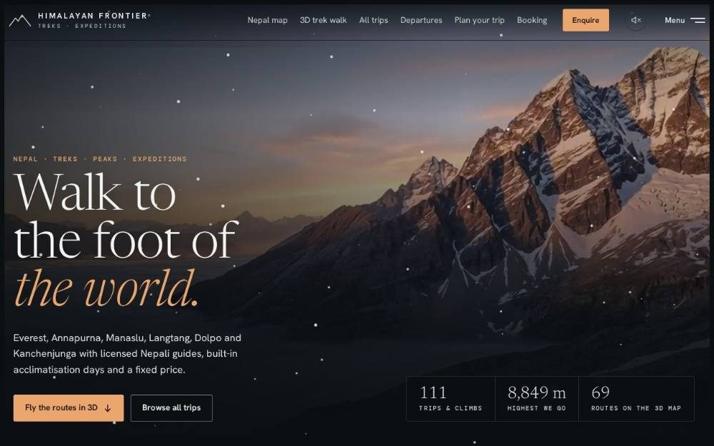
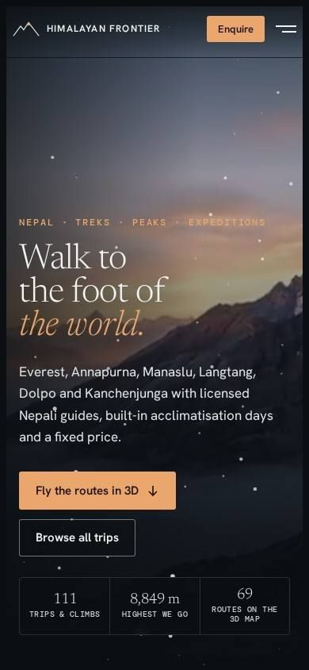

# Himalayan Frontier

**A 3D website for a Nepal trekking company.** Visitors can fly every trek route on real satellite terrain, then walk a signature trek day by day before they book. This is a demo build: the company and its contact details are placeholders.

**Live demo:** [himalayan-frontier.vercel.app](https://himalayan-frontier.vercel.app)



## Features

- **3D map of Nepal** with 69 trek, peak and expedition routes traced on satellite terrain. Tap a pin to follow a route, or press "Fly along".
- **Day-by-day 3D trek walk** for five signature treks. Scrolling moves the camera along the trail one night's stop at a time.
- **111 trips** with filters for region, length and grade, and a page for each trip with its itinerary and price.
- **Trip planning hub**: difficulty grades, seasons, permits and fees, altitude safety, packing list, visa and insurance.
- **Group departures**, booking terms and an enquiry form.
- **Films and photo archive**, an optional ambient soundscape, and a lite mode for slow connections and older phones.
- Mobile layout that fits the whole of Nepal on a phone screen.



## Tech stack

- Plain HTML, CSS and JavaScript, no build step
- [three.js](https://threejs.org) for the 3D map and the trek walk (`map3d.js`, `nepal3d.js`)
- Satellite imagery: Copernicus Sentinel-2 cloudless by EOX (CC BY 4.0); borders and rivers from Natural Earth
- Hosted on Vercel

## Files

| File | What it does |
|---|---|
| `index.html`, `styles.css` | Page structure and styles |
| `app.js` | Trips, filters, departures, enquiry form |
| `map3d.js`, `nepal3d.js` | 3D route map and day-by-day trek walk |
| `cinema.js`, `atmosphere.js` | Films reel and ambient sound |
| `company.js`, `site-config.js` | Company details and contact settings |
| `ux.js` | Navigation, lite mode and small interactions |

## Run locally

Serve the folder with any static server:

```bash
npx serve .
```

To use it for a real company, fill in phone, WhatsApp, email and licence numbers in `site-config.js` and set `demo: false`.

---

Built by **Ajit Thapa Magar**, web developer and product manager in Kathmandu. Portfolio: [ajit-portfolio-six.vercel.app](https://ajit-portfolio-six.vercel.app)
